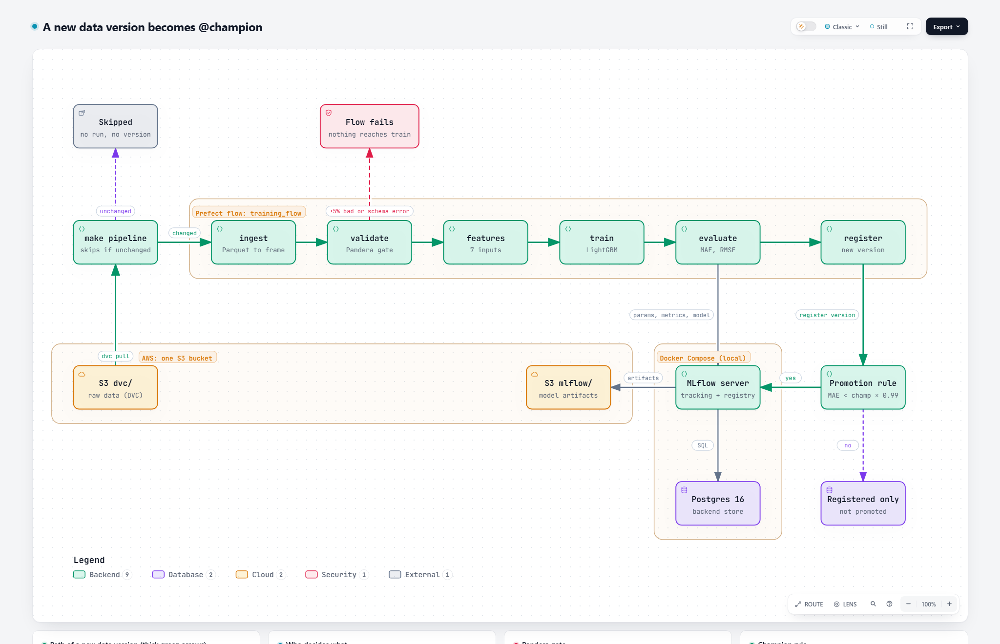

# mlops-reproducible-pipeline



[](https://github.com/KevinLopezPastor/mlops-pipeline/actions/workflows/ci.yml)

A training pipeline where every registered model traces back to the exact data version and git commit that produced it.
It predicts NYC yellow taxi trip duration (TLC trip records, Jan to Mar 2024) with LightGBM.
Data is versioned with DVC, the steps run as a Prefect 3 flow, a Pandera schema gates bad data before training,
and MLflow 3 tracks the runs and promotes a model to `@champion` only when it beats the current one.

The interactive version of the diagram is [docs/architecture.html](docs/architecture.html).

## What it does

| Step | Task | What happens |
| --- | --- | --- |
| 1 | `ingest` | Reads the Parquet files (6 columns, one file at a time to keep peak memory near 1.5 GB) and adds the target `duration_min`. |
| 2 | `validate` | The Pandera gate ([schemas/trips.py](schemas/trips.py)): duration in 0 to 1,500 min, zones 1 to 265. |
| 3 | `features` | 7 inputs known at request time. Post-trip columns (distance, fares, tips) are excluded as leakage. |
| 4 | `train` | Time split at `train.cutoff_date` (2024-03-01), LightGBM, seeded. |
| 5 | `evaluate` | MAE (primary), RMSE capped at 120 min, raw RMSE. |
| 6 | `register` | Registers a version and moves `@champion` to it only if MAE improves by at least 1%. |

**The gate has two outcomes.** Real TLC data always has a few bad rows (225 of 9.55 M here). Below 5% invalid rows
(`validate.max_invalid_fraction` in [params.yaml](params.yaml)) the gate drops them and logs the count. At 5% or more,
or if a column is missing, the flow fails and nothing reaches training. [tests/test_gate_e2e.py](tests/test_gate_e2e.py) covers both.

**The promotion rule uses MAE, not RMSE.** The target has a heavy tail (median 12.5 min, max 1,499), so a few runaway
meters dominate a squared-error metric. On the March test set the model is 40% better than the mean baseline on MAE
but only 6% better on raw RMSE. The reasoning is under "Decisions" in [docs/plan/week-01.md](docs/plan/week-01.md).

**DVC decides whether to run, Prefect and MLflow decide how.** [dvc.yaml](dvc.yaml) has one stage that wraps the flow.
`make pipeline` skips it when data, code and params match `dvc.lock`. The cost: DVC sees the flow as a black box and
caches nothing between tasks.

## Lineage

Every MLflow run carries three tags:

| Tag | Meaning |
| --- | --- |
| `lineage.git_commit` | Commit the flow ran from. |
| `lineage.git_dirty` | `True` if the working tree had uncommitted changes. A `True` run is not reproducible. |
| `lineage.dvc_data_hash` | Hash of `data/raw` from `data/raw.dvc`: the data version. |

Params from `params.yaml` are logged flat on the same run. Check a run (replace `<run_id>`):

```bash
curl -s "http://localhost:5000/api/2.0/mlflow/runs/get?run_id=<run_id>" | grep -o '"lineage[^}]*'
```

The tags are computed inside the flow, so they cannot show hashes that DVC writes after the stage finishes.
The committed `dvc.lock` is the receipt for those.

## Quick start

You need Docker, [uv](https://docs.astral.sh/uv/), Terraform, DVC (installed by `uv sync`) and an AWS account
with a profile named `ml-roadmap` in `us-east-1`. There is no offline mode: the MLflow artifacts and the DVC remote
live in one real S3 bucket, created with Terraform (the reasons for dropping MinIO are in the plan).

```bash
git clone https://github.com/KevinLopezPastor/mlops-pipeline.git && cd mlops-pipeline
uv sync
aws sso login --profile ml-roadmap

# 1. Bucket (once)
terraform -chdir=infra init && terraform -chdir=infra apply
cp .env.example .env            # set MLFLOW_BUCKET to `terraform -chdir=infra output -raw bucket_name`

# 2. Data: a pointer file in git, the Parquet files in your bucket
dvc remote modify storage url s3://$(terraform -chdir=infra output -raw bucket_name)/dvc   # see the note below
bash scripts/download_data.sh && dvc push

# 3. Stack and model
make up                         # MLflow + Postgres on http://localhost:5000
make reproduce                  # dvc pull, then train, evaluate and register
```

Open <http://localhost:5000> and look at the newest run: metrics, the three `lineage.*` tags and the registered model.
On the reference data the run gives MAE 5.4802, RMSE capped 6.9655 and raw RMSE 31.0753 (equal to a tolerance,
because float summation order can change the last digit between libraries).

**Note on the DVC remote.** [.dvc/config](.dvc/config) points to the bucket of the original author, which is private.
The `dvc remote modify` line in step 2 points the remote (named `storage`) at your own bucket; it edits `.dvc/config`,
so do not commit that change if you plan to open a PR.

### Day to day

| Command | What it does |
| --- | --- |
| `make pipeline` | `dvc repro`: skips when nothing changed, so it creates no run and no registry version. |
| `make pipeline ARGS=--force` | Forces a re-run. DVC may rewrite `data/raw.dvc` first, which makes `lineage.git_dirty` `True`: run `git checkout data/raw.dvc` before the real run. |
| `make reproduce` | `dvc pull`, then always runs the flow. For a fresh clone. |
| `make smoke` | The flow without DVC. CI uses it on the committed 1% sample (`RAW_DIR=tests/data/smoke`). |
| `make test` / `make lint` | pytest, and Ruff check plus format check. The two CI runs before the smoke job. |
| `make down` | Stops the stack. |

`register.*` params are not part of the DVC stage, because they change the promotion decision, not the trained model.
Changing them needs `make pipeline ARGS=--force`.

## Layout

```
flows/training_flow.py     Prefect flow wiring the six tasks and the MLflow run
src/taxi/                  ingest, validate, features, train, evaluate, register, lineage, params
schemas/trips.py           Pandera schema
params.yaml  dvc.yaml      parameters, and the single DVC stage
docker-compose.yml         MLflow + Postgres (artifacts proxied to S3)
infra/                     Terraform: the S3 bucket (prefixes mlflow/ and dvc/) and the GitHub OIDC role
tests/                     pytest per task, plus the end-to-end gate test
docs/plan/                 the weekly plan, decisions and progress log
```

## Reading

- [Hidden Technical Debt in Machine Learning Systems](https://papers.nips.cc/paper/2015/hash/86df7dcfd896fcaf2674f757a2463eba-Abstract.html) (Sculley et al., 2015)
- Docs: [MLflow](https://mlflow.org/docs/latest/), [DVC](https://dvc.org/doc), [Prefect](https://docs.prefect.io/), [Pandera](https://pandera.readthedocs.io/)
